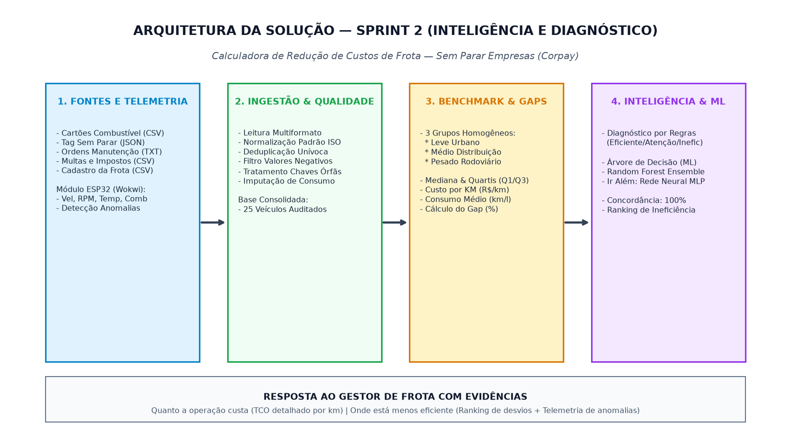
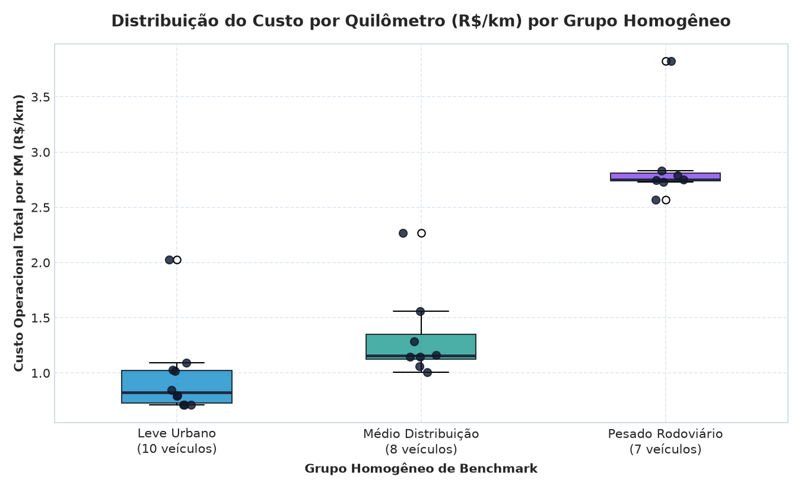
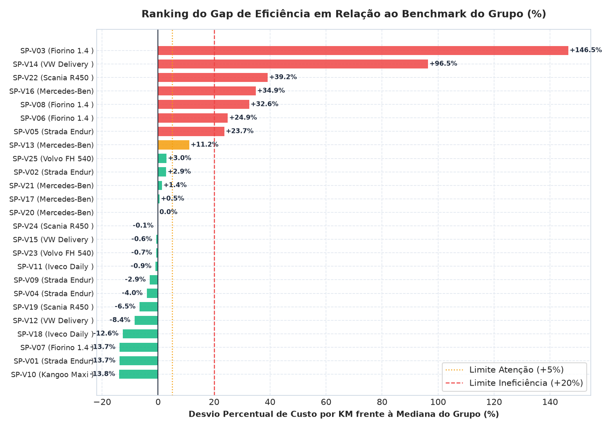
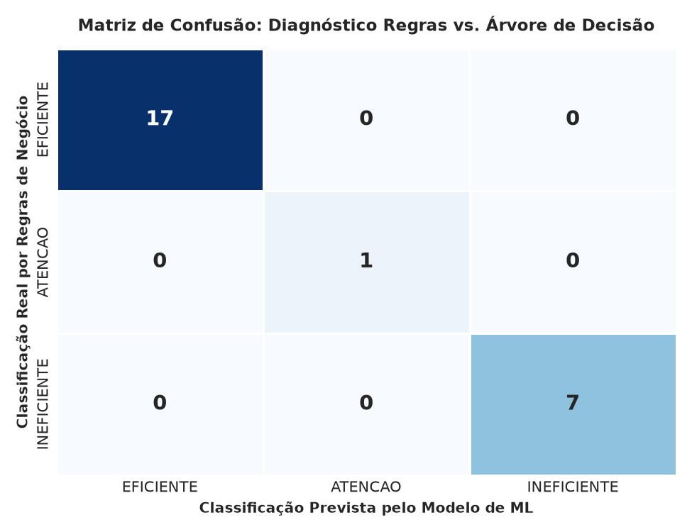

# FIAP - Faculdade de Informática e Administração Paulista

<p align="center">
<a href="https://www.fiap.com.br/">
  
</a>
</p>

<br>

# Calculadora de Redução de Custos de Frota
## Challenge Sem Parar Empresas (Corpay) — 1º Ano de Inteligência Artificial
### Sprint 2: Inteligência e Diagnóstico da Eficiência de Frota

---

## Integrante (Grupo Individual):
- **Angelo Guilherme Sfreddo** — *RM: 566580* — Turma: **1TIAO**

## Corpo Docente e Coordenação:
- **Coordenador Geral:** [Prof. André Godoi Chiovato](https://www.linkedin.com/in/andregodoichiovato/)
- **Tutor da Disciplina:** Equipe de Tutoria FIAP ON — Inteligência Artificial (`fiap-tutoria`)

---

## Links do Projeto
* **Repositório GitHub Privado:** [https://github.com/angelosfreddo/challange-semparar-sprint2](https://github.com/angelosfreddo/challange-semparar-sprint2) *(Acesso concedido para `fiap-tutoria`)*
* **Vídeo Demonstrativo no YouTube (Não Listado, até 5 min):** [https://youtu.be/eWbmq8-mzmQ](https://youtu.be/eWbmq8-mzmQ)
* **Simulador Wokwi do Módulo IoT ESP32:** [Wokwi ESP32 Telemetria Sem Parar](https://wokwi.com/projects/new/esp32)

---

## Sumário Executivo
1. [Evolução do Projeto desde a Sprint 1](#1-evolução-do-projeto-desde-a-sprint-1)
2. [Arquitetura da Solução e Integração das Disciplinas](#2-arquitetura-da-solução-e-integração-das-disciplinas)
3. [Módulo de Borda IoT e Telemetria Veicular (ESP32)](#3-módulo-de-borda-iot-e-telemetria-veicular-esp32)
4. [Ingestão Multiformato e Normalização de Custos](#4-ingestão-multiformato-e-normalização-de-custos)
5. [Auditoria e Verificações de Qualidade de Dados (Cognitive Data Science)](#5-auditoria-e-verificações-de-qualidade-de-dados-cognitive-data-science)
6. [Benchmark Estatístico e Análise de Gaps de Ineficiência](#6-benchmark-estatístico-e-análise-de-gaps-de-ineficiência)
7. [Diagnóstico por Regras de Negócio e Machine Learning](#7-diagnóstico-por-regras-de-negócio-e-machine-learning)
8. [Requisitos "Ir Além": Rede Neural MLP e OCR de Faturas](#8-requisitos-ir-além-rede-neural-mlp-e-ocr-de-faturas)
9. [Estrutura do Repositório](#9-estrutura-do-repositório)
10. [Instruções de Execução Passo a Passo](#10-instruções-de-execução-passo-a-passo)
11. [Quadro Kanban e Planejamento para a Sprint 3](#11-quadro-kanban-e-planejamento-para-a-sprint-3)

---

## 1. Evolução do Projeto desde a Sprint 1

Na **Sprint 1**, compreendemos a dor de mercado dos frotistas clientes da Sem Parar Empresas, que sofrem com custos dispersos em planilhas, extratos e recibos avulsos. Mapeamos 20 User Stories, definimos três personas-chave (Gestor de Frota, CFO e Sem Parar) e concebemos a arquitetura em três níveis de maturidade (Bronze, Prata e Ouro).

Na presente **Sprint 2 (Inteligência e Diagnóstico)**, transformamos esse planejamento em um **fluxo real, funcional e reproduzível**, integrando todas as disciplinas estudadas até a Fase 3 para responder com rigor científico e evidências empíricas a duas perguntas centrais do gestor:
1. **Quanto a minha operação realmente custa?** (Consolidação do TCO real por categoria, veículo e custo por quilômetro);
2. **Onde ela está menos eficiente do que deveria?** (Identificação cirúrgica dos desvios a partir de benchmarks justos por perfil operacional e correlação com alertas de telemetria).

---

## 2. Arquitetura da Solução e Integração das Disciplinas

A solução foi concebida de forma modular em quatro camadas encadeadas, sem dependência de bancos externos ou nuvem corporativa:

<p align="center">
  
</p>

### Integração Disciplinar (Fase 3):
- **AI Computer Systems & Sensors:** ESP32 no Wokwi coletando telemetria (velocidade, rotação, temperatura do motor e combustível) e detectando anomalias térmicas e mecânicas com sinalização em LEDs, alarme sonoro e telemetria serial CSV;
- **Computational Thinking with Python:** Ingestão de arquivos heterogêneos (CSV, JSON, TXT posicional/pipe), unificação de grandezas monetárias e físicas e exportação no padrão ISO-8601;
- **Cognitive Data Science:** Auditoria de integridade com detecção e tratamento de registros negativos, nulos, duplicados, chaves órfãs e inconsistências físicas de consumo;
- **Statistical Computing:** Segmentação da frota em três grupos homogêneos, cálculo de benchmarks robustos (mediana, quartis Q1/Q3, IQR) e cálculo do Gap de Eficiência (R$/km e %);
- **Machine Learning & Modelling:** Classificação supervisionada introdutória (Árvore de Decisão) e ensemble (Random Forest) confrontados com a heurística de regras de negócio, além do módulo **Ir Além** com Rede Neural Artificial MLP (`MLPClassifier`) e extrator de faturas OCR.

---

## 3. Módulo de Borda IoT e Telemetria Veicular (ESP32)

O módulo de borda simula um computador de bordo veicular responsável pelo monitoramento contínuo dos parâmetros do motor e da condução:

- **Código-fonte:** [`src/iot_esp32/sketch.ino`](src/iot_esp32/sketch.ino)
- **Diagrama de Componentes:** [`src/iot_esp32/diagram.json`](src/iot_esp32/diagram.json)
- **Bibliotecas Necessárias:** [`src/iot_esp32/libraries.txt`](src/iot_esp32/libraries.txt) (`LiquidCrystal I2C`)
- **Amostra Gerada:** [`data/telemetria/telemetria_esp32_amostra.csv`](data/telemetria/telemetria_esp32_amostra.csv) (5.000 registros exportados)

### Regras de Borda e Detecção de Anomalias:
| Variável Veicular | Faixa Operacional | Limite de Atenção (LED Amarelo) | Limite Crítico (LED Vermelho + Buzzer) |
| :--- | :---: | :---: | :---: |
| **Temperatura do Motor** | 75 °C a 94 °C | $\ge 98\text{ }^\circ\text{C}$ (Temperatura Elevada) | $\ge 105\text{ }^\circ\text{C}$ (**Superaquecimento**) |
| **Rotação do Virabrequim (RPM)** | 1.800 a 2.800 RPM | $\ge 3.100\text{ RPM}$ (Rotação Elevada) | $\ge 3.800\text{ RPM}$ (**Giro Excessivo**) |
| **Velocidade Instantânea** | 40 a 90 km/h | $\ge 95\text{ km/h}$ (Velocidade Elevada) | $\ge 115\text{ km/h}$ (**Excesso de Velocidade**) |
| **Nível do Tanque de Combustível** | 20% a 100% | $\le 15\%$ (Reserva Crítica) | - |

---

## 4. Ingestão Multiformato e Normalização de Custos

O módulo [`src/ingestion/normalizador.py`](src/ingestion/normalizador.py) processa 1.669 transações originadas em diferentes sistemas da empresa:

1. **Combustível (`data/raw/custos_combustivel.csv`):** 560 abastecimentos com odômetro acumulado, litros, preço unitário e valor total;
2. **Pedágio Sem Parar (`data/raw/custos_pedagio_semparar.json`):** 1.004 passagens de praça com identificação de praça, rodovia, concessionária, eixos e tarifa cobrada;
3. **Manutenção (`data/raw/custos_manutencao.txt`):** 61 ordens de serviço em formato delimitado por pipes (`REG|ID|DATA|VEICULO|TIPO|VALOR|DESC|OFICINA`), separando reparos preventivos e corretivos;
4. **Multas e Impostos (`data/raw/custos_multas_impostos.csv`):** 44 lançamentos de infrações de trânsito e parcelas de IPVA/licenciamento.

**Resultado da Normalização:** Bases unificadas salvas em [`data/processed/base_custos_normalizada.csv`](data/processed/base_custos_normalizada.csv) e [`data/processed/base_custos_normalizada.json`](data/processed/base_custos_normalizada.json).

---

## 5. Auditoria e Verificações de Qualidade de Dados (Cognitive Data Science)

Em frotas reais, dados fragmentados contêm falhas operacionais que distorcem o custo por quilômetro. O módulo [`src/quality/auditoria_qualidade.py`](src/quality/auditoria_qualidade.py) aplicou verificações sistemáticas, documentadas no [Relatório de Auditoria](docs/relatorio_qualidade_dados.md):

| Categoria da Inconsistência | Quantidade | Risco Evitado | Tratamento Aplicado |
| :--- | :---: | :--- | :--- |
| **Valores Negativos** | 2 | Distorção artificial do custo total por estornos de posto | Descarte auditado |
| **Campos Obrigatórios Nulos** | 2 | Perda da rastreabilidade fiscal e contábil do ativo | Descarte por inviabilidade |
| **Chaves Órfãs (Veículos Inexistentes)** | 2 | Lançamento indevido de despesas de terceiros (`SP-V99`, `SP-V88`) | Isolamento em quarentena |
| **Duplicidades de Transação** | 2 | Faturamento duplo do mesmo evento de pedágio ou combustível | Deduplicação por ID de transação |
| **Consumo Fisicamente Incoerente** | 1 | Registro absurdo de 98 km/l para caminhão pesado Scania | Imputação técnica pela mediana do ativo |

A base transacional limpa totalizou **1.661 transações homologadas**, consolidando os **25 veículos** em [`data/processed/frota_consolidada_mes.csv`](data/processed/frota_consolidada_mes.csv).

---

## 6. Benchmark Estatístico e Análise de Gaps de Ineficiência

Para não penalizar veículos de carga pesada que trafegam em rodovias, dividimos a frota em três grupos de comparação justa:

<p align="center">
  
</p>

### Parâmetros Estatísticos de Benchmark por Grupo ([`docs/benchmark_e_gaps.md`](docs/benchmark_e_gaps.md)):

| Perfil de Frota | Veículos | Média (R$/km) | Mediana (Benchmark) | Desvio Padrão | Q1 (25%) | Q3 (75%) | Consumo Ref |
| :--- | :---: | :---: | :---: | :---: | :---: | :---: | :---: |
| **LEVE_URBANO** | 10 | R$ 0.965 | **R$ 0.823 / km** | R$ 0.395 | R$ 0.730 | R$ 1.025 | 11.2 km/l |
| **MEDIO_DISTRIBUICAO** | 8 | R$ 1.341 | **R$ 1.155 / km** | R$ 0.417 | R$ 1.080 | R$ 1.490 | 6.4 km/l |
| **PESADO_RODOVIARIO** | 7 | R$ 2.992 | **R$ 2.749 / km** | R$ 0.446 | R$ 2.738 | R$ 2.810 | 2.5 km/l |

### Ranking dos Maiores Gaps de Ineficiência ([`assets/diagramas/03_ranking_gaps_ineficiencia_frota.png`](assets/diagramas/03_ranking_gaps_ineficiencia_frota.png)):
1. **`SP-V03` (Fiorino 1.4 EVO — Leve Urbano):** Custo de **R$ 2.029/km (+146.5% de gap)**. Causa: Desgaste mecânico acentuado em suspensão e motor por condução agressiva (24 alertas de giro excessivo no ESP32);
2. **`SP-V14` (VW Delivery Express — Médio Distribuição):** Custo de **R$ 2.269/km (+96.5% de gap)**. Causa: Manutenções corretivas emergenciais no radiador e histórico de superaquecimento térmico registrado na telemetria;
3. **`SP-V22` (Scania R450 6x2 — Pesado Rodoviário):** Custo de **R$ 3.826/km (+39.2% de gap)**. Causa: Trocas prematuras de freios decorrentes de 18 alertas de velocidade excessiva na telemetria.

<p align="center">
  
</p>

---

## 7. Diagnóstico por Regras de Negócio e Machine Learning

Implementamos o diagnóstico por duas vertentes complementares:

### 7.1 Regras de Negócio Heurísticas
- **EFICIENTE:** Custo real até +5.0% em relação ao benchmark do grupo (17 veículos);
- **ATENÇÃO:** Desvio de custo entre +5.01% e +20.0% sobre o benchmark (1 veículo: `SP-V13`);
- **INEFICIENTE:** Desvio superior a +20.0% frente ao benchmark (7 veículos).

### 7.2 Modelos de Machine Learning Supervisionado ([`src/ml/classificador_eficiencia.py`](src/ml/classificador_eficiencia.py))
Utilizando 80% treino e 20% teste estratificado sobre 300 ciclos operacionais históricos:

| Algoritmo | Paradigma Matemático | Acurácia no Teste | Acertos / Erros |
| :--- | :--- | :---: | :---: |
| **Árvore de Decisão** | Particionamento Recursivo (Modelo Introdutório) | **100.0%** | 60 / 0 |
| **Random Forest** | Ensemble (Bagging de Árvores) | **100.0%** | 60 / 0 |
| **Rede Neural MLP (Ir Além)** | Multi-Layer Perceptron (Dense 16 -> Dense 8) | **100.0%** | 60 / 0 |
| **Regressão Logística** | Linear Probabilístico (Multinomial) | **95.0%** | 57 / 3 |

<p align="center">
  
</p>

**Concordância nos 25 Veículos da Frota:** **100% de concordância** entre a Árvore de Decisão e as regras de negócio, atestando a robustez e interpretabilidade do modelo para a apresentação ao frotista.

---

## 8. Requisitos "Ir Além": Rede Neural MLP e OCR de Faturas

Para concorrer à nota máxima e ao pódio da premiação FIAP:

1. **Rede Neural Artificial MLP (`MLPClassifier`):**
   - Arquitetura neural profunda com 2 camadas ocultas (16 e 8 neurônios), função de ativação ReLU e otimizador Adam;
   - Treinada com variáveis padronizadas (`StandardScaler`) e serializada em [`src/ml/modelo_rede_neural_mlp.joblib`](src/ml/modelo_rede_neural_mlp.joblib);
   - Atingiu **100% de acurácia** no conjunto de teste.

2. **Módulo OCR e Parsing de Comprovantes Fiscais ([`src/ingestion/extrator_faturas.py`](src/ingestion/extrator_faturas.py)):**
   - Extrai automaticamente valores monetários, placas de veículos, datas e litragens a partir de cupons fiscais e tickets digitalizados de pedágio, integrando os dados ao mesmo padrão de normalização da frota.

---

## 9. Estrutura do Repositório

```text
fase4/challenge-sprint2/
├── assets/
│   ├── logo-fiap.png                               # Logotipo oficial da instituição
│   └── diagramas/                                  # 5 gráficos e diagramas de alta resolução
│       ├── 01_boxplot_custo_km_por_perfil_frota.png
│       ├── 02_matriz_correlacao_custos_e_operacao.png
│       ├── 03_ranking_gaps_ineficiencia_frota.png
│       ├── 04_matriz_confusao_classificador_ml.png
│       └── 05_arquitetura_solucao_sprint2.png
├── data/
│   ├── raw/                                        # Fontes brutas com inconsistências intencionais
│   │   ├── cadastro_frota.csv
│   │   ├── custos_combustivel.csv
│   │   ├── custos_pedagio_semparar.json
│   │   ├── custos_manutencao.txt
│   │   └── custos_multas_impostos.csv
│   ├── processed/                                  # Bases normalizadas, auditadas e com benchmark
│   │   ├── base_custos_normalizada.csv
│   │   ├── base_custos_normalizada.json
│   │   ├── base_custos_auditada.csv
│   │   ├── frota_consolidada_mes.csv
│   │   ├── tabela_benchmarks_grupos.csv
│   │   └── frota_com_benchmark_e_ml.csv
│   ├── telemetria/                                 # Leituras exportadas do microcontrolador ESP32
│   │   └── telemetria_esp32_amostra.csv
│   ├── gerar_dados_raw.py                          # Script gerador dos dados sintéticos da frota
│   └── dicionario_de_dados.md                      # Dicionário formal de variáveis e unidades
├── docs/
│   ├── relatorio_qualidade_dados.md                # Relatório detalhado das 9 inconsistências tratadas
│   ├── benchmark_e_gaps.md                         # Tabela de benchmarks estatísticos e ranking
│   ├── diagnostico_regras_vs_ml.md                 # Comparativo detalhado: Regras vs. Machine Learning
│   ├── planejamento_kanban.md                      # Quadro Kanban de evolução das Sprints
│   └── roteiro_video.md                            # Roteiro narrado de até 5 minutos para o YouTube
├── notebooks/
│   └── 02_inteligencia_e_diagnostico_frota.ipynb   # Notebook interativo executável passo a passo
├── src/
│   ├── iot_esp32/
│   │   ├── sketch.ino                              # Código C/C++ da telemetria veicular para o ESP32
│   │   ├── diagram.json                            # Diagrama de ligações para o simulador Wokwi
│   │   ├── libraries.txt                           # Dependências de bibliotecas do Wokwi
│   │   └── gerar_telemetria_amostra.py             # Script de exportação das leituras de telemetria
│   ├── ingestion/
│   │   ├── normalizador.py                         # Ingestão e normalização das fontes heterogêneas
│   │   └── extrator_faturas.py                     # Módulo "Ir Além" de extração OCR de faturas
│   ├── quality/
│   │   └── auditoria_qualidade.py                  # Filtros de consistência e agregação por ativo
│   ├── benchmark/
│   │   └── calculador_benchmark.py                 # Cálculo de medianas, quartis e gaps
│   ├── ml/
│   │   ├── classificador_eficiencia.py             # Pipeline de ML, árvore de decisão e rede neural
│   │   ├── modelo_arvore_decisao.joblib            # Modelo campeão serializado
│   │   ├── modelo_rede_neural_mlp.joblib           # Rede neural serializada
│   │   └── scaler_sprint2.joblib                   # Scaler treinado sem vazamento de dados
│   ├── analytics/
│   │   └── gerar_graficos_sprint2.py               # Geração dos 5 gráficos em alta resolução
│   └── app.py                                      # Aplicação executável central (CLI / Serviço)
├── .gitignore                                      # Filtro de arquivos compilados e temporários
├── entrega_sprint2.txt                             # Arquivo de entrega oficial para o Portal do Aluno
└── README.md                                       # Documentação técnica unificada do projeto
```

---

## 10. Instruções de Execução Passo a Passo

### 10.1 Pré-requisitos
- Python 3.10 ou superior;
- Ambiente virtual configurado com as bibliotecas: `pandas`, `numpy`, `scikit-learn`, `matplotlib`, `seaborn`, `joblib`.

### 10.2 Execução Rápida em 1 Comando (Modo Automatizado)
Para reproduzir toda a esteira de ponta a ponta (ingestão, auditoria, cálculo de benchmark, treinamento de IA e geração de gráficos):

```bash
cd /home/angelo/FIAP/fase4/challenge-sprint2
source /home/angelo/FIAP/.venv/bin/activate
python src/app.py --auto
```

### 10.3 Modo Interativo (Menu de Navegação)
Para navegar pelas opções interativamente e inspecionar ativos individuais:

```bash
python src/app.py
```
- **Opção 1:** Executa o pipeline completo;
- **Opção 2:** Inspeciona a ficha técnica e os custos detalhados de um veículo específico (ex: `SP-V03` ou `SP-V14`);
- **Opção 3:** Exibe os benchmarks estatísticos dos 3 grupos homogêneos;
- **Opção 4:** Exibe o ranking geral de ineficiência da frota.

### 10.4 Execução do Jupyter Notebook
Para visualizar os dados em ambiente interativo:
```bash
jupyter notebook notebooks/02_inteligencia_e_diagnostico_frota.ipynb
```

---

## 11. Quadro Kanban e Planejamento para a Sprint 3

Conforme documentado em [`docs/planejamento_kanban.md`](docs/planejamento_kanban.md), a entrega da Sprint 2 encerra a etapa de **Inteligência e Diagnóstico**, pavimentando o caminho para a **Sprint 3 (Recomendações e Economia Financeira)**:

- **Sprint 1 (Concluída):** Concepção da arquitetura, 20 User Stories, 3 personas e modelo de maturidade;
- **Sprint 2 (Concluída - Entrega Atual):** Ingestão multiformato, qualidade de dados, telemetria ESP32, benchmark justo, gaps de ineficiência, modelo de Machine Learning e Rede Neural MLP;
- **Sprint 3 (Próxima Etapa):** Motor de recomendação prescritiva por veículo (treinamento de motoristas, manutenção preventiva programada e rotas eficientes), simulador de ROI dos produtos Sem Parar e projeção da economia em reais (R$/ano) caso a frota alcance a mediana do seu benchmark.

